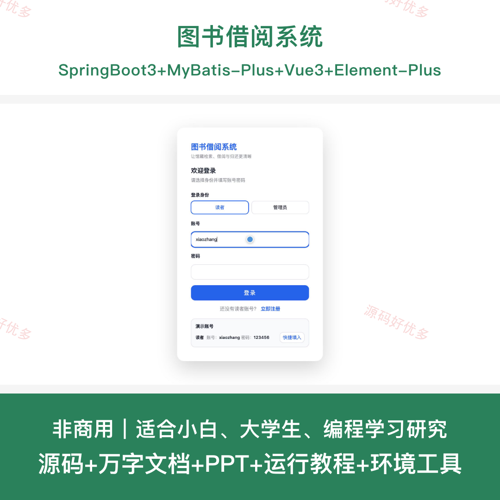
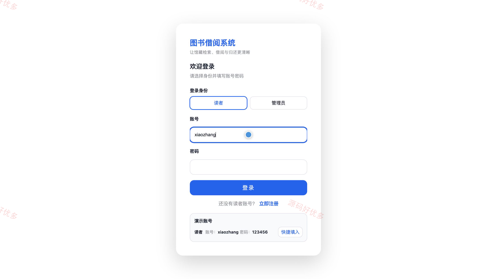
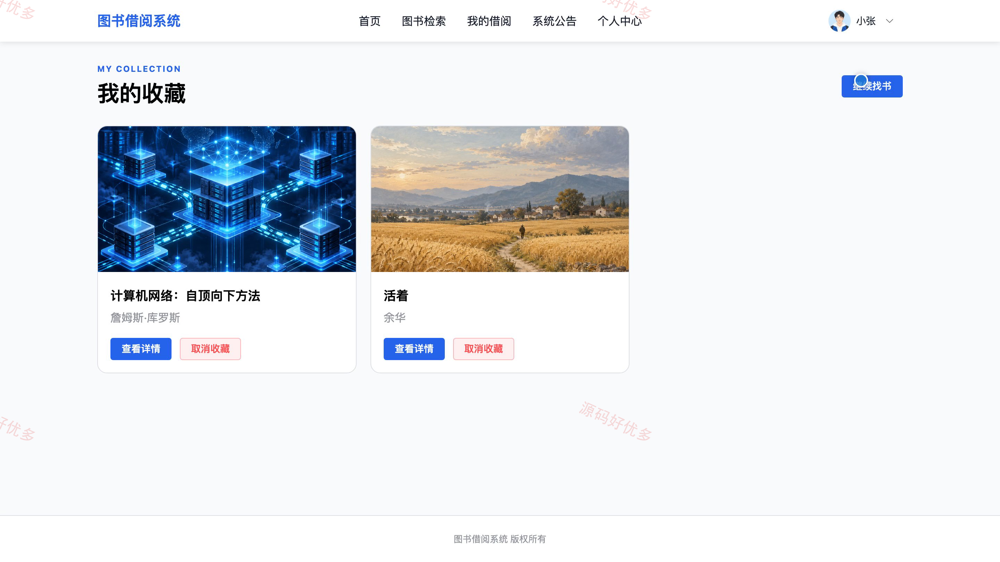
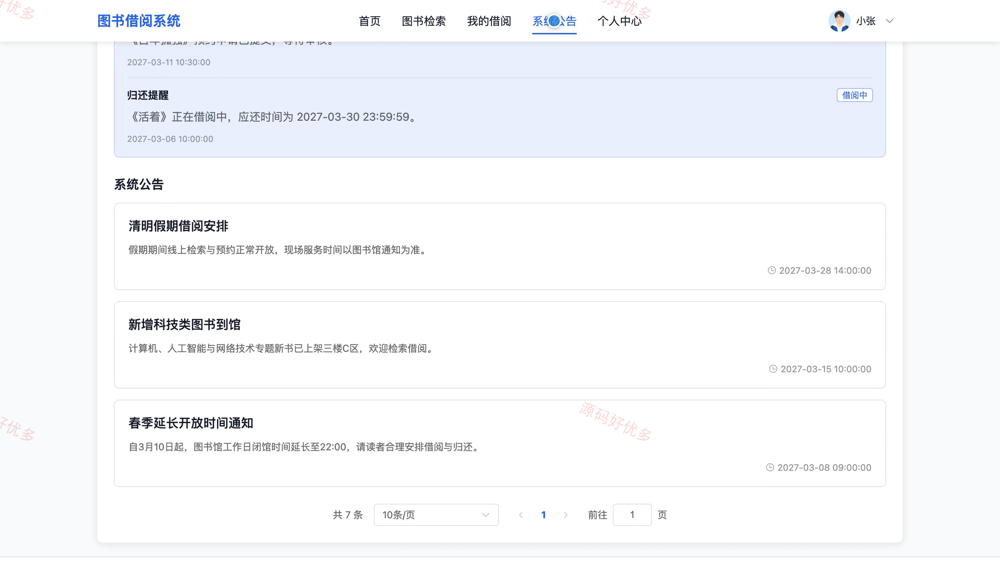
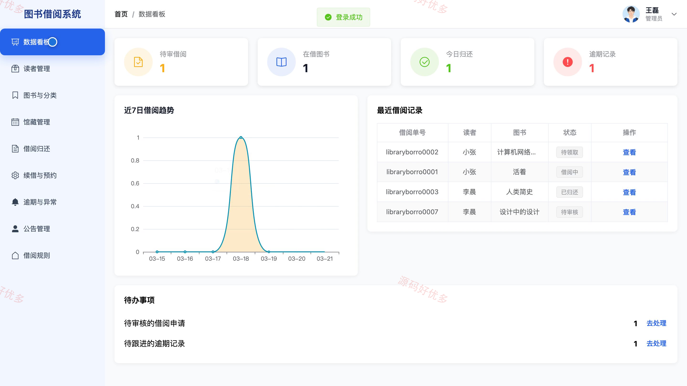
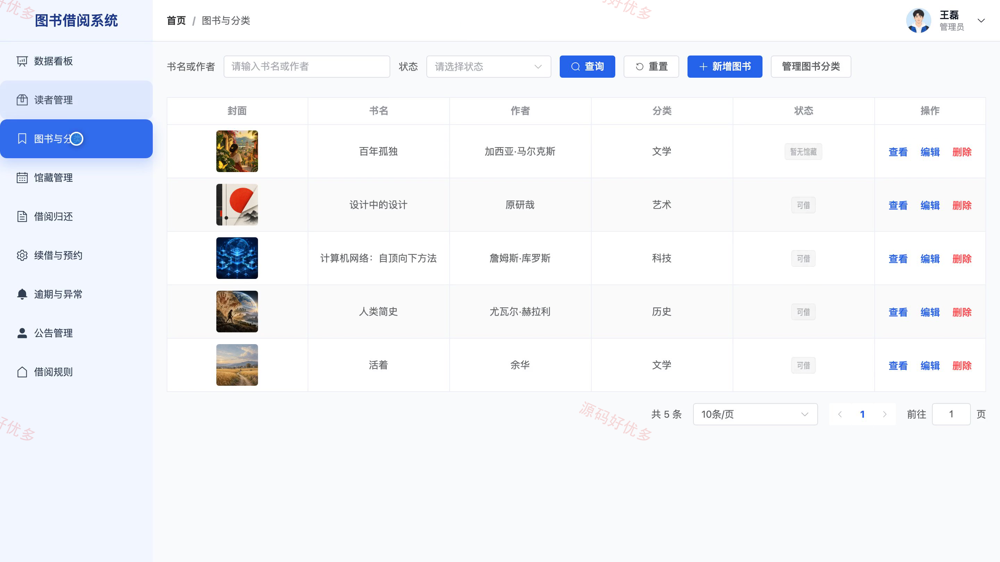
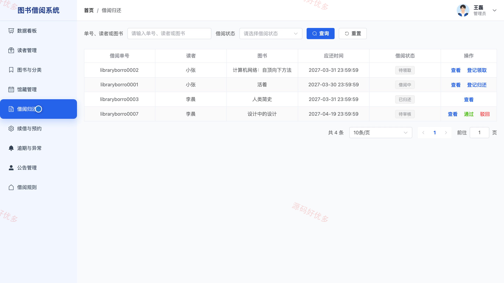
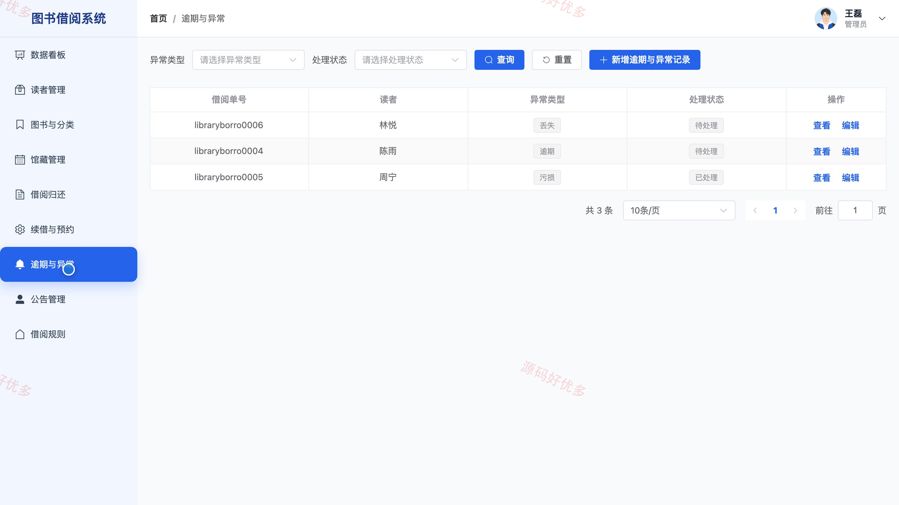

## 源码问题查看主页咨询

### 一、关键词
图书馆藏管理、读者借阅服务、图书预约、续借审核、逾期异常处理

### 二、作品包含
源码+数据库+万字设计文档+PPT+全套环境和工具资源+本地部署教程

### 三、项目技术
前端技术： Html、Css、Js、Vue3.4、Element-Plus
后端技术：Java、SpringBoot3.2.0、MyBatis-Plus

### 四、运行环境要求
开发工具：IDEA/eclipse + VSCODE

数据库：MySQL5.7+（共13张表）

数据库管理工具：Navicat10以上版本

环境配置软件： JDK17 + Maven3.6

前端Nodejs：16+

浏览器：谷歌浏览器

### 五、项目介绍
项目编号：bs122A

图书借阅系统面向读者与图书馆管理员，围绕图书检索、馆藏状态、借阅申请、续借预约和异常处理形成完整的借阅服务闭环。读者可查看图书详情与可借数量，提交借阅、续借和预约申请，并查询个人借阅记录、收藏和公告；管理员通过后台维护读者、图书、分类和馆藏数据，完成借阅归还、续借预约、逾期异常、公告与借阅规则管理。

角色：读者、管理员

读者功能：账号注册登录和资料维护、图书检索与分类筛选、图书详情和馆藏查看、借阅申请与记录查询、续借申请和结果查看、缺书预约和状态查询、图书收藏与推荐查看、公告及借阅提醒查看。

管理员功能：借阅数据看板与趋势统计、读者账号维护与启停、图书分类与基础信息维护、馆藏位置和状态管理、借阅审核与归还登记、续借与图书预约申请处理、逾期和图书异常处理、公告发布与借阅规则配置。

### 六、运行截图

